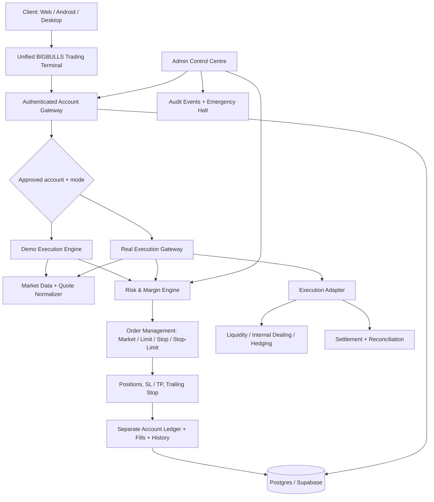

# BIGBULLS Global Trading Ecosystem — Dual Account Architecture

## Product rule

One BIGBULLS terminal serves both Demo and Real accounts. Account mode is an explicit context switch; account IDs, balances, orders, fills, positions, risk settings and histories remain isolated. No MetaTrader terminal or MT5 server integration is required for the BIGBULLS-native platform.

## Logical architecture

## Mode separation

| Area | Demo | Real |
|---|---|---|
| Account | Approved Demo account | Approved Real account |
| Balance | Simulated | Authoritative account ledger |
| Quotes | Indicative feed for simulation | Must use executable bid/ask and provider timestamps |
| Orders | Simulated | Server accepted and routed only after readiness |
| Positions / fills | Demo ledger | Real ledger, immutable fills |
| History | Demo only | Real only |
| Risk controls | Server policy | Server policy + exposure / margin controls |
| Emergency halt | Global / account | Global / account |

## Admin responsibilities

- View all account modes, order counts, open positions, fills and audit events.
- Set global risk limits and per-account overrides.
- Pause Demo execution and activate a global execution halt.
- Real execution remains locked until liquidity routing, settlement, regulatory authorization, client-funds controls, reconciliation and a production execution adapter are verified.

## Current implementation status

- Unified Demo / Real mode selector and account selector added to the existing terminal.
- Account list is loaded through the authenticated `trading-gateway` Edge Function.
- Real accounts display in the same terminal as read-only accounts; the UI blocks order actions in Real mode.
- Added separate trade order, position, fill and audit tables with owner/admin read policies and service-role-only writes.
- Added global risk policy settings and per-account risk override storage.
- Added admin global halt and global risk configuration controls.
- Live execution is deliberately disabled by default. The current public market-data feeds are indicative quote sources, not executable broker bid/ask liquidity. The existing Demo simulator still uses its browser-side paper engine; server-authoritative Demo matching and the production Real execution adapter are separate remaining engineering milestones.

## Live execution readiness gates

A server is the execution host, not automatically a source of liquidity or a settlement system. If BIGBULLS acts as principal/internal counterparty, the firm still needs sufficient capital, a defined risk book and hedging policy, legally permitted dealing permissions in each target jurisdiction, client-money controls, and independently reconcilable settlement. The gateway must fail closed unless all readiness flags and the actual execution adapter are configured.
